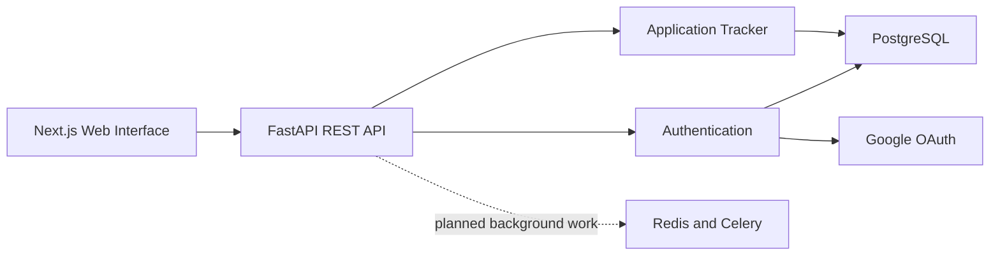

# TAL

TAL is a job-search workspace designed to bring application tracking, résumé evidence,
job discovery, and career assistance into one system.

The project is being developed as a modular monolith. A FastAPI service owns the API
and business logic, PostgreSQL stores application data, and a Next.js interface provides
the user experience. Redis and Celery are included for future scheduled and background
workloads.

> **Project status:** Active development. Authentication and the initial application
> tracker are implemented. The web interface is currently under construction.

## Current capabilities

### Backend

- Health-check endpoint
- User registration with password hashing
- Password authentication with JWT access tokens
- Google OAuth authentication
- Bearer-token and HTTP-only cookie authentication
- Current-user and logout endpoints
- External identity storage with duplicate-account protection
- Application creation, listing, retrieval, and status updates
- PostgreSQL schema management through Alembic
- Domain-level error responses
- Automated API, service, security, and model tests

### Frontend

- Next.js App Router foundation
- Responsive login interface
- Google sign-in entry point
- Initial chat workspace and navigation sidebar
- Compact message composer interface

The chat interface is currently presentational and is not yet connected to a
conversation service.

## Technology stack

| Area | Technologies |
| --- | --- |
| Backend | Python 3.12, FastAPI, Pydantic |
| Database | PostgreSQL 16, SQLAlchemy 2, Alembic |
| Authentication | JWT, Argon2 password hashing, Google OAuth |
| Frontend | Next.js 16, React 19, TypeScript, Tailwind CSS 4 |
| Background work | Redis, Celery |
| Quality | pytest, Ruff, mypy, ESLint |
| Local infrastructure | Docker Compose |

## Architecture



Feature modules are kept independent inside the backend so they can evolve without
introducing unnecessary service boundaries.

## API endpoints

All API routes use the `/api/v1` prefix.

| Method | Endpoint | Purpose |
| --- | --- | --- |
| `GET` | `/health` | Check API availability |
| `POST` | `/auth/register` | Create a password-based account |
| `POST` | `/auth/token` | Issue a JWT access token |
| `GET` | `/auth/me` | Return the authenticated user |
| `GET` | `/auth/google/login` | Start Google OAuth authentication |
| `GET` | `/auth/google/callback` | Complete Google OAuth authentication |
| `POST` | `/auth/logout` | Clear the authentication cookie |
| `POST` | `/applications/` | Create an application |
| `GET` | `/applications/` | List applications |
| `GET` | `/applications/{application_id}` | Retrieve an application |
| `PATCH` | `/applications/{application_id}/status` | Update application status |

Interactive OpenAPI documentation is available at `/docs` while the backend is
running.

## Project structure

```text
TAL/
├── frontend/                 # Next.js web application
├── migrations/               # Alembic database migrations
├── src/tal/
│   ├── api/                  # API routing and health checks
│   ├── core/                 # Configuration and shared errors
│   ├── db/                   # SQLAlchemy base and sessions
│   ├── features/
│   │   ├── applications/     # Application tracking
│   │   └── auth/             # Password and Google authentication
│   └── worker/               # Celery configuration
├── tests/                    # Backend automated tests
├── compose.yaml              # PostgreSQL and Redis services
└── pyproject.toml            # Python dependencies and tooling
```

## Local development

### Prerequisites

- Python 3.12 or later
- Node.js with npm
- Docker with Docker Compose

### 1. Clone the repository

```bash
git clone https://github.com/rammohanrediee/TAL.git
cd TAL
```

### 2. Create the Python environment

```bash
python3.12 -m venv .venv
source .venv/bin/activate
python -m pip install -e ".[dev]"
```

### 3. Configure environment variables

```bash
cp .env.example .env
```

The backend requires database, JWT, OAuth, and session secrets. Google OAuth must use
the callback URL configured by `GOOGLE_REDIRECT_URI`. Secret values must remain in the
local `.env` file and must not be committed.

### 4. Start local infrastructure

```bash
docker compose up -d
```

### 5. Apply database migrations

```bash
alembic upgrade head
```

### 6. Run the backend

```bash
uvicorn tal.main:app --reload
```

The API runs at `http://127.0.0.1:8000` by default.

### 7. Run the frontend

```bash
cd frontend
npm install
npm run dev
```

The web interface runs at `http://localhost:3000` by default.

## Quality checks

Backend checks:

```bash
pytest
ruff check .
mypy
```

Frontend checks:

```bash
cd frontend
npm run lint
npm run build
```

## Roadmap

- Associate applications with authenticated users
- Add authorization for user-owned resources
- Complete the application tracking interface
- Add résumé upload, parsing, and structured evidence storage
- Ingest and normalize jobs from approved public sources
- Add deterministic, explainable job matching
- Introduce scheduled discovery and reminder jobs
- Connect the conversational interface to controlled backend tools
- Add evidence-grounded résumé tailoring with version history
- Expand observability, rate limiting, privacy controls, and deployment automation

## Product boundary

TAL does not automatically submit job applications. The planned workflow provides
application links, preparation assistance, tracking, and explicit user-controlled
actions. Résumé tailoring is intended to remain evidence-grounded and must not invent
experience or qualifications.
